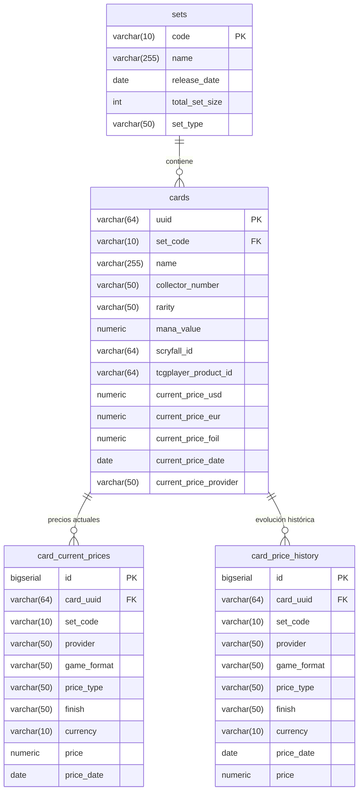

# 🔮 Pipeline de Ingesta Big Data: Magic: The Gathering (PySpark + Apache Airflow + Docker Compose + Jaeger)

Este proyecto implementa un pipeline ETL/ELT robusto, escalable y automatizado para la descarga, transformación, almacenamiento en Data Lake (formato Parquet) y carga en Data Warehouse (PostgreSQL) del catálogo completo de expansiones (Sets), cartas y precios multitienda de *Magic: The Gathering* utilizando **Apache Airflow**, **PySpark**, **PostgreSQL**, **OpenTracing / OpenTelemetry + Jaeger** y **Docker Compose**.

---

## 🏛️ 1. Arquitectura de la Solución

```mermaid
graph TD
    subgraph Fuentes de Datos [MTGJSON API v5]
        A1[SetList.json.gz]
        A2[Individual Sets: {SET_CODE}.json.gz]
        A3[AllPricesToday.json.gz / AllPrices.json.gz]
    end

    subgraph Orquestación [Apache Airflow 2.9]
        DAG1[DAG 1: all_sets_ingestion]
        DAG2[DAG 2: selected_set_ingestion<br/><i>Selector interactivo de Sets</i>]
    end

    subgraph Cluster Dedicado Apache Spark [Master + Workers]
        SM[Spark Master<br/><i>spark://spark-master:7077<br/>Web UI: :9090</i>]
        SW[Spark Worker 1<br/><i>2 Cores / 2GB RAM<br/>Web UI: :9091</i>]
        SM --- SW
    end

    subgraph Observabilidad Distribuida [OpenTracing / OpenTelemetry + Jaeger]
        JG[Jaeger All-In-One UI & Collector<br/><i>http://localhost:16686<br/>OTLP :4318 / :4317</i>]
        LG[Correlación de Logs & Trazas<br/><i>trace_id + span_id + jaeger_url</i>]
    end

    subgraph Data Lake [Almacenamiento Parquet Snappy]
        DL1[(data/lake/sets/sets.parquet)]
        DL2[(data/lake/cards_prices/{SET_CODE}.parquet<br/><i>1 archivo Parquet por set</i>)]
        DL3[(data/lake/price_history/{SET_CODE}.parquet)]
    end

    subgraph Data Warehouse [PostgreSQL 15 - mtg_dw]
        DB1[(Tabla: sets)]
        DB2[(Tabla: cards)]
        DB3[(Tabla: card_current_prices<br/><i>Snapshot de mercado</i>)]
        DB4[(Tabla: card_price_history<br/><i>Series temporales para gráficas</i>)]
    end

    A1 --> DAG1 --> SM
    A2 & A3 --> DAG2 --> SM
    SM --> SW
    SW --> DL1 & DL2 & DL3
    SW --> DB1 & DB2 & DB3 & DB4
    SM -.-> JG
    SW -.-> JG
    DAG1 & DAG2 -.-> LG -.-> JG
```

---

## 📋 2. Cobertura de Requerimientos

| # | Requerimiento | Implementación |
|---|---|---|
| **1** | **Descargar todos los sets y almacenarlos en Parquet** | El job `spark_jobs/process_sets.py` descarga `SetList.json.gz`, normaliza los esquemas con PySpark DataFrame, guarda en `data/lake/sets/sets.parquet` y realiza upsert en PostgreSQL (`sets`). |
| **2** | **Selector interactivo de set(s) en Airflow por ID** | El DAG `selected_set_ingestion` utiliza `airflow.models.param.Param` para permitir seleccionar o escribir los IDs de las ediciones (ej. `["MH3", "FDN"]`, `["BLB"]`, `["OTJ", "NEO"]`). |
| **3** | **Descargar cartas + detalles + precios: 1 Parquet por cada set** | El job `spark_jobs/process_cards_and_prices.py` genera exactamente **1 archivo Parquet cohesivo por cada set** en `data/lake/cards_prices/{SET_CODE}.parquet` cruzando cartas y cotizaciones por `uuid`. |
| **4** | **Carga en PostgreSQL diferenciando múltiples sets y precios con tabla de histórico para gráficas** | Modelo relacional optimizado:<br>• `uuid` único por impresión física de carta.<br>• `card_current_prices` para snapshot actual multitienda (TCGPlayer, Cardmarket, CardKingdom, etc.).<br>• `card_price_history` para almacenar series temporales y calcular tendencias de precios día a día. |
| **5** | **Trazabilidad Distribuida (OpenTracing) y Jaeger con Logs Correlacionados** | Módulo `spark_jobs/tracing_utils.py` con instrumentación de funciones de Spark (`@trace_function`, `trace_span`), exportación OTLP hacia Jaeger All-In-One (`http://localhost:16686`) y formateador de logs con inyección automática de `trace_id`, `span_id` y URLs de visualización de trazas. |
| **6** | **Implementación en Docker Compose** | Arquitectura contenerizada con `postgres:15-alpine`, `jaegertracing/all-in-one:1.57`, `spark-master`, `spark-worker`, `airflow-webserver`, `airflow-scheduler` y `airflow-init`. |

---

## 🗄️ 3. Modelo de Base de Datos en PostgreSQL (`mtg_dw`)

### ¿Cómo se diferencian cartas en múltiples sets y con múltiples precios?
1. **Identificador Único (`uuid`):** En el ecosistema MTGJSON, cada impresión física de una carta (incluso reimpresiones con el mismo nombre como *Lightning Bolt* o *Ragavan*) posee un `uuid` único vinculado a su `set_code`.
2. **Precios Multitienda:** Una carta puede tener cotizaciones en diferentes tiendas (`provider`: TCGPlayer, Cardmarket, CardKingdom, etc.), formatos (`game_format`: paper, mtgo), canales (`price_type`: retail, buylist) y acabados (`finish`: normal, foil, etched). La restricción única `(card_uuid, provider, game_format, price_type, finish, currency)` garantiza la diferenciación y actualización atómica.
3. **Histórico para Gráficas:** Cada cambio o registro diario de precio se guarda con su fecha `price_date` en `card_price_history`, permitiendo consultar la serie temporal completa de cualquier carta.



---

## 📁 4. Estructura del Proyecto

```text
├── dags/
│   ├── all_sets_ingestion.py        # DAG 1: Descarga y procesa catálogo de sets
│   └── selected_set_ingestion.py    # DAG 2: Ingesta interactiva por set(s)
│
├── spark_jobs/
│   ├── tracing_utils.py             # Módulo OpenTracing / OpenTelemetry + Jaeger
│   ├── common_utils.py              # Sesión Spark, PyArrow Parquet writer, Logging trazado
│   ├── process_sets.py              # PySpark ETL Sets -> Parquet & Postgres
│   └── process_cards_and_prices.py  # PySpark ETL Cartas/Precios -> Parquet & Postgres
│
├── sql/
│   ├── init_db.sql                  # DDL de tablas, índices y vistas analíticas
│   └── init-multiple-dbs.sh         # Script entrypoint para crear db mtg_dw
│
├── data/                            # Almacenamiento local / Lake
│   ├── raw/                         # Archivos JSON/GZ descargados
│   └── lake/                        # Data Lake en formato Parquet
│       ├── sets/                    # sets.parquet
│       ├── cards_prices/            # {SET_CODE}.parquet (1 por cada set)
│       └── price_history/           # {SET_CODE}.parquet (histórico)
│
└── tests/                           # Pruebas automatizadas
    ├── test_spark_pipeline.py       # Tests unitarios del pipeline de datos
    └── test_tracing.py              # Tests de OpenTracing, Jaeger y Logs
```

---

## 🚀 5. Instrucciones de Despliegue y Ejecución

### Prerrequisitos
- Docker y Docker Compose instalados y en ejecución.

### Paso 1: Configurar Variables de Entorno
```bash
cp .env.example .env
```

### Paso 2: Iniciar los Contenedores con Docker Compose
```bash
docker compose up -d --build
```

Verifica que los contenedores estén saludables:
```bash
docker compose ps
```

### Paso 3: Acceder a las Interfaces Web
- **MTG Explorer Web App (FastAPI + SolidJS):** **[http://localhost:8000](http://localhost:8000)** (Explorador interactivo M3 de cartas y cotizaciones)
- **API Swagger Docs (FastAPI):** **[http://localhost:8000/docs](http://localhost:8000/docs)** (Documentación OpenAPI interactiva)
- **Apache Airflow Web UI:** **[http://localhost:8080](http://localhost:8080)** (Usuario: `admin`, Contraseña: `admin`)
- **Jaeger Observability & Tracing UI:** **[http://localhost:16686](http://localhost:16686)** (Monitoreo de trazas distribuidas y spans de Spark)
- **Apache Spark Master Web UI:** **[http://localhost:9090](http://localhost:9090)** (Monitor de cluster y workers)
- **Apache Spark Worker 1 Web UI:** **[http://localhost:9091](http://localhost:9091)** (Monitor de hilos y memoria de ejecución)
- **PostgreSQL Data Warehouse:** `localhost:5432` (Base de datos: `mtg_dw`, Usuario: `airflow`, Password: `airflow`)

---

## 🔄 6. Ejecución de los DAGs en Airflow

### DAG 1: `all_sets_ingestion` (Catálogo de Sets)
- **Función:** Descarga todos los sets oficiales (> 800 expansiones), genera el archivo Parquet `data/lake/sets/sets.parquet` y actualiza la tabla `sets` en PostgreSQL.
- **Ejecución:** Haz clic en el botón **Play (Trigger DAG)** o actívalo para ejecución diaria automática.

### DAG 2: `selected_set_ingestion` (Cartas y Precios por Set)
- **Función:** Permite seleccionar uno o varios sets para descargar todas sus cartas, cruzar los precios de mercado, generar **1 archivo Parquet por cada set** y poblar `cards`, `card_current_prices` y `card_price_history`.
- **Selector Interactivo:**
  1. En la lista de DAGs, haz clic en el botón desplegable junto al botón de Play en `selected_set_ingestion`.
  2. Selecciona **"Trigger DAG with config"**.
  3. En el formulario visual interactivo, edita el parámetro `set_codes`:
     - Ejemplo: `["MH3", "FDN", "BLB"]`
  4. *(Opcional)* Activa `load_history` si deseas los 90 días completos de historial en lugar de solo hoy.
  5. Haz clic en **Trigger**.

---

## 📊 7. Consultas Analíticas y Gráficas de Precios en PostgreSQL

Puedes conectarte a la base de datos `mtg_dw` con herramientas como **DBeaver**, **Tableau**, **PowerBI** o vía `psql`:

```bash
docker exec -it mtg_postgres psql -U airflow -d mtg_dw
```

### Consulta 1: Comparativa de Precios Actuales entre Tiendas para una Carta
```sql
SELECT 
    c.name AS carta,
    s.name AS edicion,
    cp.provider AS tienda,
    cp.finish AS acabado,
    cp.currency AS moneda,
    cp.price AS precio_actual,
    cp.price_date AS fecha_cotizacion
FROM cards c
JOIN sets s ON c.set_code = s.code
JOIN card_current_prices cp ON c.uuid = cp.card_uuid
WHERE c.name ILIKE '%Ragavan, Nimble Pilferer%'
ORDER BY cp.price ASC;
```

### Consulta 2: Serie Temporal Histórica para Graficar Evolución de Precio
```sql
SELECT 
    c.name AS carta,
    c.set_code AS edicion,
    h.provider AS tienda,
    h.finish AS acabado,
    h.price_date AS fecha,
    h.price AS precio
FROM card_price_history h
JOIN cards c ON h.card_uuid = c.uuid
WHERE c.name ILIKE '%Black Lotus%'
  AND h.provider = 'tcgplayer'
ORDER BY h.price_date ASC;
```

### Consulta 3: Evolución con Porcentaje de Variación Día a Día (Vista `v_card_price_trends`)
```sql
SELECT 
    card_name,
    set_name,
    provider,
    finish,
    price_date,
    previous_price,
    price AS current_price,
    price_diff,
    pct_change AS porcentaje_cambio
FROM v_card_price_trends
WHERE set_code = 'MH3'
  AND pct_change IS NOT NULL
ORDER BY ABS(pct_change) DESC
LIMIT 20;
```

---

## 🔍 8. Observabilidad Distribuida: OpenTracing & Jaeger con Correlación de Logs

El pipeline cuenta con instrumentación completa de **OpenTracing / OpenTelemetry** integrada con el colector y la interfaz web de **Jaeger**:

### 🎯 Características de Observabilidad:
1. **Instrumentación de Funciones Spark:**
   - Decorador `@trace_function` y context manager `trace_span` en `spark_jobs/tracing_utils.py`.
   - Medición automática de duración de cada etapa, conteo de filas, bytes leídos/escritos, consultas SQL y fallos.
   - Spans granulares para inicialización de Spark Session, descargas HTTP, transformaciones DataFrame, exportación Parquet y upserts en PostgreSQL.

2. **Correlación Directa entre Logs y Trazas (Logs-to-Traces):**
   - Formato de logs estructurado con inyección automática de `trace_id` (32 hex) y `span_id` (16 hex):
     ```text
     [2026-10-09 04:25:10] [INFO] [trace_id=4bf92f3577b34da6a3ce929d0e0e4736 span_id=00f067aa0ba902b7] MTGPipeline: Guardando Parquet de cartas del set 'MH3'...
     ```
   - **Enlace directo a Jaeger en los logs:** Cada job imprime la URL exacta para inspeccionar la ejecución:
     ```text
     🔗 Jaeger Trace disponible: http://localhost:16686/trace/4bf92f3577b34da6a3ce929d0e0e4736
     ```
   - **Sincronización Bidireccional:** Los logs emitidos durante la ejecución se replican como eventos anotados dentro del propio span en la UI de Jaeger.

3. **Acceso a Jaeger UI:**
   - Abre **[http://localhost:16686](http://localhost:16686)** en tu navegador.
   - Selecciona el servicio `mtg-spark-pipeline` o `mtg-airflow-spark` y haz clic en **"Find Traces"**.
   - Haz clic en cualquier traza para ver el diagrama en cascada con la jerarquía de llamadas y los logs asociados.

---

## 🧪 9. Ejecución de Pruebas Automatizadas

Para ejecutar la suite completa de pruebas unitarias y de trazabilidad:
```bash
python -m unittest discover -s tests -v
```
O dentro del contenedor de Airflow / Web App:
```bash
docker exec -it mtg_web_app python -m unittest discover -s tests -v
```

---

## 🎨 10. Aplicación Web Full-Stack (FastAPI + SolidJS + Material Design 3)

La aplicación web interactiva se encuentra disponible en **[http://localhost:8000](http://localhost:8000)** (con documentación OpenAPI interactiva en `/docs`).

### 🌟 Funcionalidades Principales:
1. **Pantalla Completa Dedicada de Detalle de Carta (`CardDetailScreen`):**
   - Acceso directo mediante clic en cualquier carta del catálogo o navegación por URL con hash (`#/card/{uuid}`).
   - Botón de retroceso fluido (`← Volver al Catálogo`) que preserva la posición de scroll y los filtros de búsqueda aplicados.
   - Vista de arte en alta resolución, Oracle Text formateado, desglose de atributos (CMC, rareza, ilustrador, set, acabados).
   - Enlaces externos directos a Scryfall y TCGPlayer.

2. **Motor de Estadísticas y Variación de Precios Dinámico:**
   - **Filtros Reactivos:**
     - Por Tienda / Proveedor (`tcgplayer`, `cardmarket`, `cardkingdom`, `manapool`, `cardhoarder`, etc.).
     - Por Acabado (`Normal`, `Foil ✨`, `Etched`).
     - Por Canal / Formato (`Retail - Venta`, `Buylist - Compra`, `Paper`, `MTGO`).
     - Por Rango Temporal (`7 Días`, `30 Días`, `90 Días`, `180 Días`, `Histórico Completo`).
     - Por Moneda (`USD $`, `EUR €`).
   - **Tarjetas KPI con Estadísticas Agregadas (M3 Cards):**
     - **Precio Actual:** Última cotización registrada para la combinación de filtros seleccionada.
     - **Cambio y Variación de Precio:** Diferencia absoluta (`+$X.XX` / `-$X.XX`) y porcentaje de variación (`+X.X%` / `-X.X%`) con indicadores de tendencia (verde subida 🟢 ↗ / rojo bajada 🔴 ↘ / gris estable ➖).
     - **Mínimo Histórico:** Menor precio registrado en el período seleccionado.
     - **Máximo Histórico:** Mayor cotización registrada en el período.
     - **Precio Promedio:** Media ponderada de precios en la ventana analizada.
   - **Gráfica Interactiva de Evolución Temporal (SVG):**
     - Curva suave con degradado de área, líneas guía de referencia y escala automática.
     - Tooltips flotantes en hover que muestran fecha, tienda, acabado, precio exacto y porcentaje de variación punto a punto.
   - **Tabla Detallada Día a Día:**
     - Historial exhaustivo con desglose de fecha, tienda, acabado (badges Foil), precio actual, precio previo, diferencia monetaria y porcentaje de variación ordenable por fecha, precio o variación absoluta.

3. **Pop-up / Popover con Ordenamiento de Precios por Tienda:**
   - Al pasar el cursor sobre cualquier carta en el catálogo se despliega un pop-up que compara las cotizaciones en diferentes tiendas.
   - Selector interactivo para ordenar cotizaciones en tiempo real por:
     - 🟢 **Menor Precio**
     - 🔴 **Mayor Precio**
     - 🏪 **Tienda (A-Z)**
     - ✨ **Acabado (Foil)**
   - Botón de acción directo para abrir la pantalla completa con estadísticas y gráficas.

4. **API REST FastAPI (`/api/v1/`):**
   - `GET /api/v1/cards`: Búsqueda paginada, filtros por texto, colores, tipos, rarezas, rangos de maná, precios y ordenamiento.
   - `GET /api/v1/cards/{uuid}`: Detalle de carta con metadatos del set y cotizaciones actuales multitienda.
   - `GET /api/v1/cards/{uuid}/price-history`: Historial filtrable por tienda, acabado, formato, moneda y días, calculando variaciones y estadísticas agregadas.
   - `GET /api/v1/filters/metadata`: Catálogo agregado de sets, tipos, rarezas y métricas.

