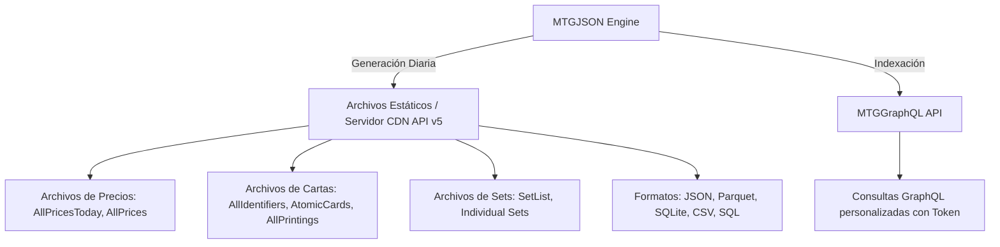
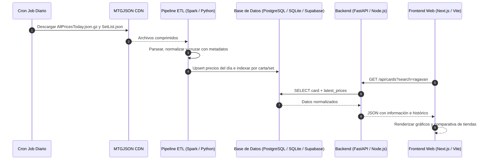

# Análisis de MTGJSON: APIs, Archivos Expuestos y Guía para Web de Precios

Este documento analiza en profundidad el funcionamiento de **MTGJSON** (fuente: [https://mtgjson.com/getting-started/](https://mtgjson.com/getting-started/)), detallando las APIs disponibles, el catálogo de archivos descargables, sus esquemas de datos y la arquitectura recomendada para crear una **plataforma web de consulta y seguimiento de precios de Magic: The Gathering**.

---

## 1. ¿Qué es MTGJSON y cómo expone su información?

MTGJSON es un proyecto open-source que recopila, estandariza y publica diariamente metadatos completos de todas las cartas, expansiones y productos sellados de *Magic: The Gathering*, junto con precios de los principales mercados del mundo.

MTGJSON ofrece **dos mecanismos principales de consumo**:



---

## 2. Métodos de Acceso a los Datos: APIs vs Archivos

### A. Archivos Estáticos / CDN ("API de Archivos")
Es el método principal, gratuito, libre y sin restricciones estrictas de tokens. Se accede directamente vía HTTPS:
- **Base URL:** `https://mtgjson.com/api/v5/<NombreArchivo>.<ext>`
- **Formatos disponibles:** `.json`, `.json.gz`, `.json.bz2`, `.json.xz`, `.json.zip`, `.sql`, `.sqlite`, `.psql`, `.parquet`, `.csv`.
- **Frecuencia de actualización:** Diaria (los precios se agregan y promedian cada 24h).

> [!TIP]
> Para aplicaciones en producción o procesamiento de Big Data (p. ej. con PySpark, DuckDB o Pandas), es altamente recomendable descargar las versiones comprimidas (`.json.gz`) o en formato **Parquet** (`AllPrintingsParquetFiles.zip`), lo que reduce drásticamente el ancho de banda y el consumo de memoria.

---

### B. MTGGraphQL API
Es una API GraphQL moderna construida directamente sobre el dataset de MTGJSON.

* **Endpoint:** `POST https://graphql.mtgjson.com/`
* **Autenticación:** Requiere cabecera HTTP `authorization: Bearer <Access_Token>` (actualmente en fase beta para miembros de Patreon / Discord de MTGJSON).
* **Rate Limits:** 1,000 peticiones/hora por IP y 500 peticiones/hora por Token.
* **Paquete Oficial NPM:** [`mtggraphql`](https://www.npmjs.com/package/mtggraphql)

**Ejemplo de consulta GraphQL para precios:**
```graphql
query {
  cards(
    filter: { name_eq: "Black Lotus" }
    page: { take: 10, skip: 0 }
  ) {
    name
    setCode
    rarity
    prices {
      provider
      date
      cardType
      listType
      price
    }
  }
}
```

---

## 3. Catálogo de Archivos Clave para la Web de Precios

Para construir una plataforma de precios autónoma y de alto rendimiento, los siguientes archivos son los más importantes:

| Archivo | URL Base / Descarga | Descripción y Utilidad |
| :--- | :--- | :--- |
| **`AllPricesToday.json`** | `https://mtgjson.com/api/v5/AllPricesToday.json` | **Archivo estrella de precios actuales.** Contiene los precios del día de hoy de todas las cartas, agrupados por `uuid`. Pesa mucho menos que el histórico. |
| **`AllPrices.json`** | `https://mtgjson.com/api/v5/AllPrices.json` | Contiene los precios de los **últimos 90 días** para todas las cartas. Ideal para generar gráficos de tendencias y velas de precios. |
| **`AllIdentifiers.json`** | `https://mtgjson.com/api/v5/AllIdentifiers.json` | Diccionario clave-valor `uuid -> Card (Set)`. Contiene toda la información de la carta (nombre, edición, rareza, imagen, ID Scryfall, ID TCGplayer). |
| **`SetList.json`** | `https://mtgjson.com/api/v5/SetList.json` | Listado ligero de todas las expansiones de MTG (código, nombre, fecha de lanzamiento, tipo de set, cantidad de cartas). |
| **`AtomicCards.json`** | `https://mtgjson.com/api/v5/AtomicCards.json` | Cartas únicas por nombre (reglas y texto oráculo, sin repeticiones de reimpresiones). |
| **`TcgplayerSkus.json`** | `https://mtgjson.com/api/v5/TcgplayerSkus.json` | Mapeo de identificadores SKU específicos de TCGPlayer para generar enlaces directos de compra o afiliados. |
| **Sets Individuales** | `https://mtgjson.com/api/v5/{SET_CODE}.json` (ej. `MH3.json`) | Archivo que contiene cartas y precios de una sola edición. Muy útil para sincronizaciones parciales o bajo demanda. |

---

## 4. Estructura y Esquema del Modelo de Precios (`Price Model`)

El modelo de precios en MTGJSON está estructurado de la siguiente forma jerárquica:

```
uuid (Identificador único de la carta)
 └── paper / mtgo (Formato físico o digital)
      └── provider (tcgplayer | cardmarket | cardkingdom | cardsphere | manapool | cardhoarder)
           ├── currency (USD, EUR, etc.)
           ├── retail (Precios de venta al público)
           │    ├── normal (Precios normales {"YYYY-MM-DD": 12.50})
           │    ├── foil   (Precios foil {"YYYY-MM-DD": 25.00})
           │    └── etched (Precios etched foil)
           └── buylist (Precios de compra de tiendas al usuario)
                ├── normal
                ├── foil
                └── etched
```

### Ejemplo de JSON de Precios (`AllPricesToday.json` / `AllPrices.json`)

```json
{
  "meta": {
    "date": "2026-10-02",
    "version": "5.2.2"
  },
  "data": {
    "17ba3f87-a0a4-57aa-a035-71da051c91cf": {
      "paper": {
        "tcgplayer": {
          "currency": "USD",
          "retail": {
            "normal": {
              "2026-10-02": 45.20
            },
            "foil": {
              "2026-10-02": 89.99
            }
          },
          "buylist": {
            "normal": {
              "2026-10-02": 32.00
            }
          }
        },
        "cardmarket": {
          "currency": "EUR",
          "retail": {
            "normal": {
              "2026-10-02": 38.50
            }
          }
        }
      }
    }
  }
}
```

### Relación entre Carta y Precio

Para mostrar una carta en la web, se cruza el `uuid`:
1. En `AllIdentifiers.json` encontramos el objeto de la carta:
   - `name`: "Ragavan, Nimble Pilferer"
   - `setCode`: "MH2"
   - `number`: "138"
   - `rarity`: "mythic"
   - `identifiers.scryfallId`: `"071d613c-d86f-46ff-a577-3d09e0dd39fa"` (utilizado para obtener la imagen de Scryfall CDN: `https://cards.scryfall.io/normal/front/...`)
2. En `AllPricesToday.json` buscamos el mismo `uuid` para obtener los precios de TCGplayer, Cardmarket, etc.

---

## 5. Arquitectura Recomendada para la Web de Precios

Para una web de precios moderna, escalable y rápida, se recomienda un pipeline desacoplado:



### Componentes de la Solución:

1. **Ingesta Diaria (ETL):**
   - Tarea programada (Cron / Celery / Airflow) a las 00:00 UTC.
   - Descarga `AllPricesToday.json.gz` (o `AllPrices.json` para carga inicial de 90 días).
   - Descarga `AllIdentifiers.json.gz` y `SetList.json` si hubo nuevo release.

2. **Almacenamiento (Base de Datos):**
   - **Tabla `sets`:** `code`, `name`, `release_date`, `card_count`, `icon_svg_uri`.
   - **Tabla `cards`:** `uuid`, `name`, `set_code`, `number`, `rarity`, `mana_cost`, `type_line`, `scryfall_id`, `image_url`.
   - **Tabla `prices_daily`:** `uuid`, `date`, `provider`, `market_type` (retail/buylist), `finish` (normal/foil/etched), `currency`, `price`.

3. **Backend API:**
   - Búsqueda por texto (Full-text search sobre nombre de carta).
   - Filtros por edición, formato (Standard, Modern, Commander), rareza y rango de precios.
   - Endpoint de carta con evolución de precios: `GET /api/cards/{uuid}/history`.
   - Mayores subidas y bajadas del día (*Gainers & Losers*).

4. **Frontend:**
   - Buscador rápido con autocompletado e imágenes.
   - Tabla comparativa de precios en tiempo real entre tiendas (TCGplayer vs Cardmarket vs CardKingdom).
   - Selector de moneda (USD / EUR).
   - Gráficos interactivos de evolución temporal (con Chart.js o Recharts).

---

## 6. Ejemplo Práctico de Procesamiento en Python / PySpark

Ejemplo de script Python ligero para descargar y parsear el archivo del día:

```python
import gzip
import json
import urllib.request

# 1. Descarga en memoria del archivo comprimido del día
url = "https://mtgjson.com/api/v5/AllPricesToday.json.gz"
req = urllib.request.Request(url, headers={'User-Agent': 'MTGPriceApp/1.0'})

with urllib.request.urlopen(req) as response:
    with gzip.GzipFile(fileobj=response) as uncompressed:
        prices_data = json.loads(uncompressed.read().decode('utf-8'))

print(f"Versión de datos: {prices_data['meta']['version']}")
print(f"Total de cartas con precio hoy: {len(prices_data['data'])}")

# 2. Ejemplo de extracción para una carta específica
for uuid, channels in list(prices_data['data'].items())[:5]:
    paper_prices = channels.get('paper', {})
    tcg = paper_prices.get('tcgplayer', {}).get('retail', {}).get('normal', {})
    cardmarket = paper_prices.get('cardmarket', {}).get('retail', {}).get('normal', {})
    
    print(f"UUID: {uuid}")
    print(f"  TCGplayer Retail Normal: {tcg}")
    print(f"  Cardmarket Retail Normal: {cardmarket}")
```

---

## 7. Próximos Pasos para el Proyecto

1. **Fase 1 (Carga Inicial):** Descargar `SetList.json` y `AllIdentifiers.json` para poblar la base de datos de cartas y ediciones.
2. **Fase 2 (Ingesta de Precios):** Cargar `AllPrices.json` para obtener los primeros 90 días de historial de precios.
3. **Fase 3 (Automatización):** Configurar la actualización diaria con `AllPricesToday.json`.
4. **Fase 4 (Desarrollo Web):** Construir la interfaz de usuario con buscador, comparador entre proveedores y gráficas de fluctuación.
